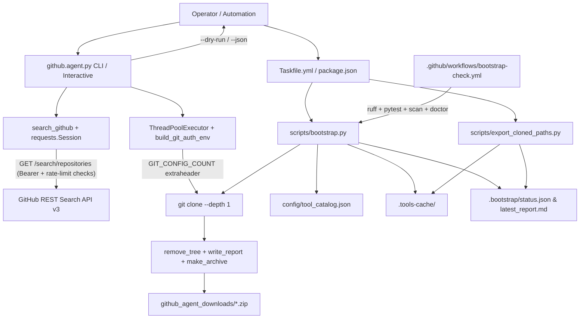
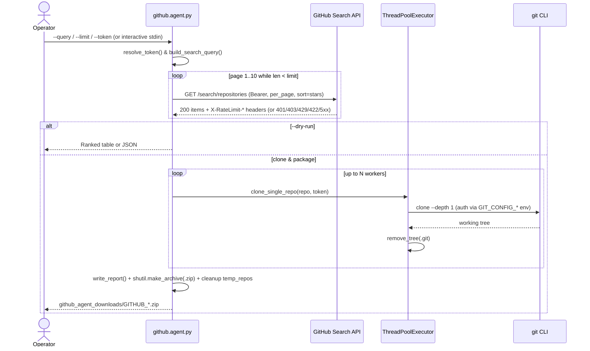

# Github-agent

Github-agent combines two focused Python tools in one repository:

1. **`github.agent.py`** — An interactive and scriptable GitHub repository collector that queries the GitHub REST Search API (`GET /search/repositories`), shallow-clones matched repositories concurrently (`git clone --depth 1`), strips `.git` metadata, and packages a ZIP archive with a search summary report under `github_agent_downloads/`.
2. **`scripts/bootstrap.py`** — A declarative toolchain control plane that reads `config/tool_catalog.json` (44 entries: 13 CLIs, 30 reference repositories, 1 URL) and tracks installation, cloning, and verification state into `.bootstrap/status.json` and `.bootstrap/latest_report.md`.

---

## How the GitHub API Collector Works

### 1. Authentication & Credential Hygiene (`requests` + `git`, plus `gh` catalog verification)

- **HTTP Client Choice**: The collector uses `requests.Session` directly against the GitHub REST Search API v3 (`https://api.github.com/search/repositories`) and `git` subprocesses for cloning — it does **not** use PyGitHub or `httpx`. The GitHub CLI (`gh`) is tracked and verified separately by `scripts/bootstrap.py` via `config/tool_catalog.json`.
- **Token Resolution Precedence**: `resolve_token()` resolves credentials in order: `--token` CLI flag -> `GITHUB_TOKEN` -> `GH_TOKEN` -> interactive prompt (or anonymous search if left blank).
- **REST API Headers**: Requests send `Accept: application/vnd.github+json`, `X-GitHub-Api-Version: 2022-11-28`, `User-Agent: Github-Agent-v2`, and `Authorization: Bearer <token>` when authenticated.
- **No Token Leakage in `git clone` URLs**: Rather than embedding PATs into `https://<token>@github.com/...` command arguments (which exposes secrets in `ps` / process listings), `build_git_auth_env()` injects credentials via Git's environment config mechanism (`GIT_CONFIG_COUNT=1`, `GIT_CONFIG_KEY_0=http.https://github.com/.extraheader`, `GIT_CONFIG_VALUE_0=AUTHORIZATION: basic <base64(x-access-token:TOKEN)>`) alongside `GIT_TERMINAL_PROMPT=0`.

### 2. Pagination, Deduplication & Rate-Limit Handling

- **Bounded Page Sizing**: Each page requests `per_page = min(100, max(1, limit - len(repos_found)))` with `sort=stars` and `order=desc`, avoiding over-fetching when `--limit` is small.
- **Stop Conditions & Deduplication**: Paging stops when `limit` is reached, `items` is empty, `len(items) < per_page`, `total_count` is satisfied, or `page > 10` (GitHub Search API's 1,000-result cap). Repositories are deduplicated by `full_name` across pages in case star rankings shift mid-pagination.
- **HTTP Status & Rate-Limit Diagnostics**:
  - `401`: Invalid or expired token — prints diagnostic and returns `[]`.
  - `403` / `429`: Parses `X-RateLimit-Remaining`, `X-RateLimit-Reset` (converted to UTC ISO-8601), and `Retry-After`, logs the exact reset window, stops paging, and preserves any already-fetched results.
  - `422`: Invalid GitHub search query syntax — prints diagnostic and returns `[]`.
  - `5xx`: Retries up to `max_retries` with linear backoff before stopping cleanly.

### 3. Concurrent Cloning & Packaging Pipeline

1. **Preflight & Query Composition**: Requires `git` on `PATH` (skipped in `--dry-run` mode). `build_search_query()` optionally appends `language:<lang>` and `stars:>=<N>` without duplicating qualifiers already present in `--query`.
2. **Dry-Run & JSON Mode**: Passing `--dry-run` (optionally with `--json`) prints ranked repository metadata and exits without cloning or writing archives.
3. **Parallel Shallow Clones**: `package_repos()` runs `ThreadPoolExecutor(max_workers=1..16)` (default `8`) calling `git clone --depth 1` with a 180-second per-repo timeout and `tqdm` progress bar.
4. **Cross-Platform `.git` Cleanup**: `remove_tree()` uses a `chmod` read-only handler (`_handle_remove_readonly`) so Windows/POSIX read-only git packfiles are removed cleanly. Failed clones clean up partial directories.
5. **Report & ZIP Output**: Writes `temp_repos/_RAPPORT_DE_RECHERCHE.txt` with a UTC timestamp, archives `temp_repos/` to `github_agent_downloads/GITHUB_<query>_<timestamp>.zip`, and removes `temp_repos/`.

---

## How Bootstrap Works

`python scripts/bootstrap.py all` executes five idempotent stages backed by `.bootstrap/status.json`:

| Stage | Behavior |
| --- | --- |
| `scan` | Detects CLIs via `local_bin`, `detect` command, or `PATH`; checks `.tools-cache/<cache_dir>` for repos; marks URLs as N/A for install/clone. |
| `install` | Runs catalog `install` commands for missing relevant CLIs (creating `package.json` if needed for npm). Records `manual_install` hints on failure. |
| `clone` | Shallow-clones (`--depth 1`, 60s timeout) reference repos into `.tools-cache/<cache_dir>`. |
| `verify` | Verifies CLIs via `verify` (+ optional `verify_contains`), repos via `README*` presence, and URLs via `curl -IsS`. |
| `report` | Renders the 7-column Markdown matrix (`Tool/Repo`, `Relevant?`, `Installed?`, `Cloned?`, `Verified?`, `Used in plan?`, `Notes`) to stdout and `.bootstrap/latest_report.md`. |

`bootstrap.py doctor` checks `python3`, `git`, `task`, `mise`, `uv`, `ruff`, `lefthook`, `node`, and `npm` (resolving `.cmd` shims via `shutil.which` on Windows) and exits `1` if any check fails. `scripts/export_cloned_paths.py` indexes cloned directories in `.tools-cache/` into `.bootstrap/cloned_repo_paths.{txt,md}`.

---

## Architecture



### Collector Execution Sequence



---

## Tools, Skills, APIs & Engineering Practices Demonstrated

| Category | Demonstrated in This Repository |
| --- | --- |
| **APIs & Protocols** | GitHub REST Search API v3 (`GET /search/repositories`, `X-GitHub-Api-Version: 2022-11-28`, `Bearer` auth, pagination, `X-RateLimit-*` / `Retry-After` inspection), HTTPS Git transport via `GIT_CONFIG_COUNT` extraheader |
| **Python Ecosystem** | Python 3.12/3.13, `requests` (`Session` reuse), `tqdm`, `argparse`, `concurrent.futures.ThreadPoolExecutor`, `subprocess`, `shutil`, `zipfile`, timezone-aware `datetime` (`UTC`), bounded `requirements.txt` & `requirements-dev.txt` |
| **Testing & Quality** | `pytest` (12 unit & CLI tests covering pagination, deduplication, HTTP 401/403/422/5xx handling, credential-env hygiene, read-only `.git` cleanup, ZIP packaging, and bootstrap matrix), `ruff check`, `ruff format --check`, `pyproject.toml`, `lefthook.yml` pre-commit hooks |
| **Automation & CI/CD** | `Taskfile.yml`, `.mise.toml`, `uv`, `.github/workflows/bootstrap-check.yml` (runs Ruff lint/format, `pytest` via `uv`, `task bootstrap:scan`, `task doctor`) |
| **Security & Reliability** | Zero secrets in process `argv` or clone URLs (`GIT_CONFIG_*` header injection), non-interactive `GIT_TERMINAL_PROMPT=0`, read-only packfile cleanup on Windows/POSIX, partial-clone cleanup on error/timeout |

---

## Setup and Usage

### Collector (`github.agent.py`)

```bash
python -m pip install -r requirements.txt

# Non-interactive dry-run (no cloning, hits GitHub Search API)
python github.agent.py --query "portfolio" --language python --limit 3 --dry-run

# JSON dry-run with minimum stars filter
python github.agent.py --query "fastapi" --min-stars 1000 --limit 3 --dry-run --json

# Full clone + ZIP packaging (uses GITHUB_TOKEN / GH_TOKEN if set)
python github.agent.py --query "trading bot" --language python --limit 5 --workers 4

# Interactive mode (prompts for token, query, and count)
python github.agent.py
```

### Development, Tests & Bootstrap

```bash
# Lint, format check, and unit tests
ruff check .
ruff format --check .
uv run --no-project --with-requirements requirements.txt --with pytest pytest -v

# Bootstrap control plane
python scripts/bootstrap.py doctor
python scripts/bootstrap.py scan
python scripts/bootstrap.py verify
python scripts/bootstrap.py report
python scripts/export_cloned_paths.py
```

On a machine with `task` and `uv` installed (see `Taskfile.yml`):

```bash
task setup          # uv venv, uv pip install, lefthook install
task lint           # ruff check .
task format:check   # ruff format --check .
task test           # pytest -v
task doctor
task bootstrap      # scan -> install -> clone -> verify -> report
```

`.gitignore` excludes `github_agent_downloads/`, `.tools-cache/`, `.bootstrap/`, `.venv/`, `node_modules/`, `.pytest_cache/`, and `.ruff_cache/`.

---

## Observed Verification Snapshot

From the latest verified run documented in [docs/PROOF_OF_WORK.md](docs/PROOF_OF_WORK.md):

- **`ruff check .` & `ruff check . --isolated`**: `All checks passed!` (exit `0`).
- **`ruff format --check .`**: `10 files already formatted` (exit `0`).
- **`pytest -v` (via `uv run`)**: `12 passed` (9 collector tests + 3 bootstrap/export tests, exit `0`).
- **Live `--dry-run` CLI demo**: `python github.agent.py --query "portfolio" --language python --limit 3 --dry-run` returned `emmabostian/developer-portfolios` (27,679 stars), `ranaroussi/quantstats` (7,862 stars), and `LuckyOne7777/LLM-Trading-Lab` (7,552 stars).
- **`bootstrap.py` matrix**: Verified `gh`, `uv`, `ruff`, and `skills.sh` (`HTTP/2 308` -> `https://www.skills.sh/`) out of 44 catalog entries without mutating the host via `install` or cloning 30 external repos.

---

## Repository Layout

| Path | Role |
| --- | --- |
| `github.agent.py` | GitHub REST Search API collector, parallel shallow-cloner, and ZIP packager |
| `tests/test_github_agent.py` | Unit tests for API pagination, rate-limit/error handling, credential env hygiene, `.git` cleanup, ZIP output, and CLI flags |
| `tests/test_bootstrap.py` | Unit tests for `tool_catalog.json` schema, scan/verify/report matrix, and `export_cloned_paths.py` |
| `scripts/bootstrap.py` | Toolchain `scan`, `install`, `clone`, `verify`, `report`, and `doctor` runner |
| `scripts/bootstrap_retry.py` | Local cache env setup, DNS preflight, and `bootstrap.py all` wrapper |
| `scripts/onboard.sh` | Fresh-clone onboarding script (Homebrew/uv + retry wrapper) |
| `scripts/export_cloned_paths.py` | Indexes `.tools-cache/` into `.bootstrap/cloned_repo_paths.{txt,md}` |
| `config/tool_catalog.json` | 44-entry inventory (13 CLIs, 30 repos, 1 URL) |
| `pyproject.toml` | Pytest and Ruff configuration |
| `requirements.txt` / `requirements-dev.txt` | Runtime (`requests`, `tqdm`) and dev/test (`pytest`, `ruff`) dependencies |
| `Taskfile.yml` | Task automation entrypoints |
| `.mise.toml` | Runtime version pins (`python = "3.13"`, `node = "24"`) |
| `lefthook.yml` | Pre-commit `ruff check` and `ruff format --check` hooks |
| `.github/workflows/bootstrap-check.yml` | CI workflow (Ruff lint/format, `pytest`, `bootstrap:scan`, `doctor`) |
| `docs/CASE_STUDY.md` | Engineering case study & design decisions |
| `docs/PROOF_OF_WORK.md` | Verbatim command transcripts and CI run references |
| `docs/OPERATING_CONTRACT.md` | Archived operating policy document |
