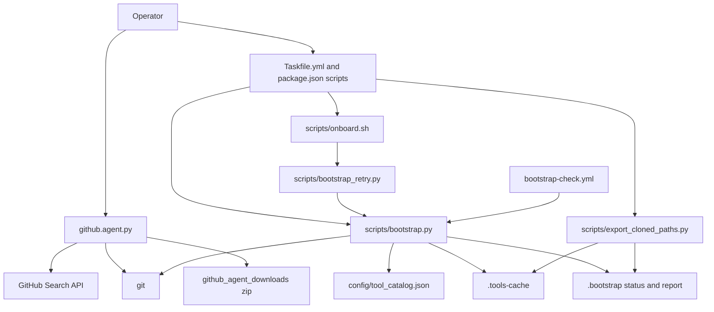
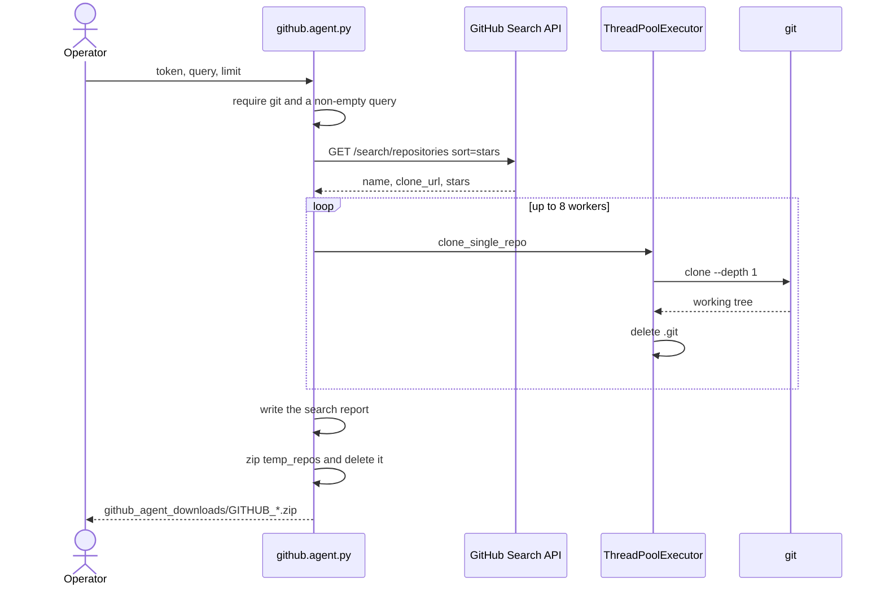
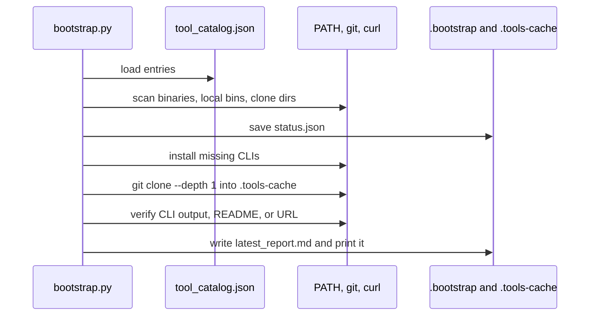

# Github-agent

Github-agent is two Python programs in one repository.

`github.agent.py` is an interactive collector. It asks for a search, calls the GitHub Search API, shallow-clones the matches in parallel, deletes each `.git` directory, and writes one zip under `github_agent_downloads/`.

`scripts/bootstrap.py` is a toolchain control plane. It reads `config/tool_catalog.json` (44 entries: 13 CLIs, 30 reference repositories, 1 URL) and records whether each item is installed, cloned, and verified.

Both programs are ordinary Python. The tree contains no prompt templates, tool-calling schemas, or model SDK. The workflow is the fixed sequence below.

## How the collector runs

1. Print the banner and require `git` on `PATH`. Exit 1 when `git` is missing.
2. Ask for a GitHub token, a search query, and a count. An empty query exits 1. A non-numeric count becomes 10.
3. Recreate `github_agent_downloads/temp_repos/`.
4. `GET https://api.github.com/search/repositories` with `sort=stars`, `order=desc`, and `per_page=100`. Page until the requested count is met, a page is empty, the API returns a non-200 status, or 10 pages have been read. A 401 returns no repositories. A 403 stops paging and keeps whatever was already collected. Results are sorted by stars again before return.
5. Clone with a pool of 8 workers. Each clone is `git clone --depth 1`, with `GIT_TERMINAL_PROMPT=0` and a 180 second timeout. When a token is present, it is inserted into the HTTPS clone URL.
6. Delete `.git` inside each successful clone. A failed clone deletes its partial directory. An existing target directory is treated as a skip and does not count as a success.
7. Write `temp_repos/_RAPPORT_DE_RECHERCHE.txt`, zip that directory to `github_agent_downloads/GITHUB_<query>_<timestamp>.zip`, then delete `temp_repos/`.

The only third-party imports in the collector are `requests` and `tqdm`. Everything else is the Python standard library.

## How bootstrap runs

`python3 scripts/bootstrap.py all` runs five steps. Each step updates `.bootstrap/status.json`. The report step also writes `.bootstrap/latest_report.md`.

| Step | What it does |
| --- | --- |
| `scan` | For a CLI, look for `local_bin`, run `detect`, or search `PATH`. For a repo, check `.tools-cache/<cache_dir>`. For a URL, record that install and clone do not apply. |
| `install` | Run the catalog `install` command for each relevant CLI that is not already present. npm installs create `package.json` when it is missing. A failure stores the `manual_install` string in Notes. |
| `clone` | `git clone --depth 1` into `.tools-cache/<cache_dir>`, 60 second timeout. |
| `verify` | CLI: run `verify` and, when set, require `verify_contains`. Repo: require a `README*` file. URL: run the catalog command (`curl` for skills.sh). |
| `report` | Print a seven-column markdown table and write the same text to `.bootstrap/latest_report.md`. |

The columns are `Tool/Repo`, `Relevant?`, `Installed?`, `Cloned?`, `Verified?`, `Used in plan?`, and `Notes`.

No catalog entry sets `relevant` or `used_in_plan` to false, so every row is marked relevant and used. `doctor` does not read the catalog. It checks `python3`, `git`, `task`, `mise`, `uv`, `ruff`, `lefthook`, `node`, and `npm`, and exits 1 when any check fails.

`scripts/bootstrap_retry.py` creates local pip and npm cache directories, warns when `/opt/homebrew/Cellar` is not writable, resolves `github.com`, `skills.sh`, `registry.npmjs.org`, and `pypi.org`, then runs `bootstrap.py all`. `scripts/onboard.sh` tries to install `task` and `uv` with Homebrew, creates a uv virtualenv, installs `requirements.txt`, and then calls the retry script. `scripts/export_cloned_paths.py` lists directories in `.tools-cache/` into `.bootstrap/cloned_repo_paths.txt` and `.bootstrap/cloned_repo_paths.md`.

## Architecture



## Tool-execution sequence

Collector, from `main()`:



Bootstrap, from `run_all()`:



## Demo walkthrough

These commands were run on 13 November 2026 on Linux. Python was 3.12.3. `mise` was not installed, so the `.mise.toml` pins (Python 3.13, Node 24) were not applied. Node on this machine was v22.23.4. No GitHub token was used, and no repository was cloned. The full transcripts are in [docs/PROOF_OF_WORK.md](docs/PROOF_OF_WORK.md).

There is no test suite and no `--dry-run` flag. The safe path is compile, doctor, scan, verify, report, the collector's empty-query exit, and an in-process search that stops before `clone_single_repo`.

Compile and shell syntax both exited 0:

```text
python3 -m py_compile github.agent.py scripts/bootstrap.py scripts/bootstrap_retry.py scripts/export_cloned_paths.py
bash -n scripts/onboard.sh
```

`python3 scripts/bootstrap.py doctor` exited 1:

```text
OK   python3 --version :: Python 3.12.3
OK   git --version :: git version 2.43.0
FAIL task --help :: missing binary: [Errno 2] No such file or directory: 'task'
FAIL mise --version :: missing binary: [Errno 2] No such file or directory: 'mise'
FAIL uv --version :: missing binary: [Errno 2] No such file or directory: 'uv'
FAIL ruff --version :: missing binary: [Errno 2] No such file or directory: 'ruff'
FAIL lefthook version :: missing binary: [Errno 2] No such file or directory: 'lefthook'
OK   node --version :: v22.23.4
OK   npm --version :: 10.9.9
```

`scan`, `verify`, and `report` then exited 0. Of 44 rows, `gh` verified (`gh version 2.103.0 (2026-10-21)`) and `skills.sh` verified (`curl` returned `HTTP/2 308` to `https://www.skills.sh/`). The other 12 CLIs were not installed. All 30 reference repositories were uncloned. `python3 scripts/export_cloned_paths.py` printed `exported=0`.

The collector was given an empty token and an empty query on stdin. It printed the banner and exited 1. The error is on the same line as the prompt because stdin was a pipe, so the newline was not echoed:

```text
   👉 Recherche : ❌ Vous devez écrire quelque chose !
```

`search_github("portfolio language:python", 3, "")` was then called directly, which performs the API request and does not clone. With `requests` 2.34.2 installed from the unpinned `requirements.txt`, the API returned:

```text
27679	emmabostian/developer-portfolios	https://github.com/emmabostian/developer-portfolios.git
7861	ranaroussi/quantstats	https://github.com/ranaroussi/quantstats.git
7551	LuckyOne7777/LLM-Trading-Lab	https://github.com/LuckyOne7777/LLM-Trading-Lab.git
```

`ruff` 0.17.5 was installed into a temporary prefix because it was not on `PATH`, then run the way `Taskfile.yml` declares. That first `ruff check` exited 1 with 14 findings. `ruff format --check` exited 1: `github.agent.py` would be reformatted, and the three scripts were already formatted. The findings are listed in the proof doc.

GitHub Actions run [43350160230](https://github.com/Anwarito-lbd/Github-agent/actions/runs/43350160230) then failed in the Setup ruff step. `astral-sh/ruff-action@v3` runs `ruff check` by default, and it reported the same 14 rules. The follow-up commit fixes those findings, marks the four Python entrypoints executable, and formats `github.agent.py`. After that commit, `ruff check .` and `ruff format --check` on the four Python files both exited 0 with ruff 0.17.5. The empty-query path still exits 1, and the same search call still returns three repositories.

`bootstrap.py install`, `clone`, `all`, and `bootstrap_retry.py` were not run. They install host packages and clone 30 third-party repositories.

## Verified tools, frameworks, and packages

Versions below come from the files named in the source column, or from a command output quoted in the proof doc. Application code imports `requests` and `tqdm` only. Biome, Nx, Playwright, and Vercel are declared dependencies and catalog entries. No source file imports them.

### Python (`requirements.txt`)

The file lists two unpinned packages. The versions in the last column are what `pip` resolved on 13 November 2026 during the search demo. They are not pins.

| Package | Manifest | Resolved in this run |
| --- | --- | --- |
| `requests` | `requirements.txt` | 2.34.2 |
| `tqdm` | `requirements.txt` | 4.70.1 |

Standard library modules used by the Python sources: `argparse`, `json`, `os`, `pathlib`, `re`, `shutil`, `socket`, `subprocess`, `sys`, `concurrent.futures`, `datetime`. `github.agent.py` also imports `time` and does not use it (`ruff` F401).

### npm (`package.json` and `package-lock.json`)

`package.json` name `github-agent-bootstrap`, version `0.1.0`, private. Lockfile version 3. The lockfile `packages` object has 455 entries (451 unique `name@version` strings). Direct devDependencies and the versions the lockfile resolved:

| Package | Range in package.json | Locked version | License in lockfile |
| --- | --- | --- | --- |
| `@biomejs/biome` | `^2.4.9` | 2.4.9 | MIT OR Apache-2.0 |
| `nx` | `^22.6.1` | 22.6.1 | MIT |
| `playwright-cli` | `^0.262.0` | 0.262.0 | Apache-2.0 |
| `vercel` | `^50.37.0` | 50.37.0 | Apache-2.0 |

`node_modules/` was not installed during this pass. `npm ls playwright-cli` still ran against `package.json` and reported an empty tree, which is why the catalog row for `playwright-cli` stayed unverified.

### Runtimes (`.mise.toml`)

| Tool | Pinned value |
| --- | --- |
| `python` | 3.13 |
| `node` | 24 |

### Task runner, hooks, and CI

| Piece | Where it is declared |
| --- | --- |
| go-task | `Taskfile.yml` (`version: '3'`), 12 tasks |
| Lefthook | `lefthook.yml`, pre-commit `ruff check` and `ruff format --check` on staged `*.py` |
| GitHub Actions | `.github/workflows/bootstrap-check.yml` |

Actions and tools named in the workflow:

| Action or install | Use |
| --- | --- |
| `actions/checkout@v4` | checkout |
| `jdx/mise-action@v2` | mise |
| `go-task/setup-task@v1` | task |
| `astral-sh/setup-uv@v6` | uv |
| `astral-sh/ruff-action@v3` | ruff |
| lefthook `v2.2.2` release binary | `lefthook_${version}_Linux_x86_64.gz` or `Linux_arm64`, installed onto `PATH` |

The workflow then runs `task bootstrap:scan` and `task doctor`. The first three runs on this branch failed before those steps. Run [43351099399](https://github.com/Anwarito-lbd/Github-agent/actions/runs/43351099399) completed with every step successful, including scan and doctor. The proof doc has the doctor lines.

### Catalog CLIs and the URL (`config/tool_catalog.json`)

| Name | Id | Kind | Install line from the catalog |
| --- | --- | --- | --- |
| `gh` | `gh-cli` | cli | `brew install gh` |
| `task` | `task-cli` | cli | `brew install go-task` |
| `mise` | `mise-cli` | cli | `brew install mise` |
| `lefthook` | `lefthook-cli` | cli | `brew install lefthook` |
| `uv` | `uv-cli` | cli | `brew install uv` |
| `ruff` | `ruff-cli` | cli | `brew install ruff` |
| `biome` | `biome-cli` | cli | `npm install --save-dev @biomejs/biome` |
| `nx` | `nx-cli` | cli | `npm install --save-dev nx` |
| `supabase` | `supabase-cli` | cli | `brew install supabase/tap/supabase` |
| `vercel` | `vercel-cli` | cli | `npm install --save-dev vercel` |
| `stripe` | `stripe-cli` | cli | `brew install stripe/stripe-cli/stripe` |
| `playwright-cli` | `playwright-cli` | cli | `npm install --save-dev playwright-cli` |
| `notebooklm-py` | `notebooklm-py` | cli | `python3 -m pip install notebooklm-py` |
| `skills.sh` | `skills-sh` | url | No install. Verify is `curl -IsS --max-time 10 https://skills.sh`. |

### Catalog repositories

Each row is `kind: repo`. Bootstrap clones the URL into the cache directory with `--depth 1`.

| Name | Id | Clone URL | Cache directory |
| --- | --- | --- | --- |
| `VoltAgent/awesome-claude-code-subagents` | `repo-awesome-claude-code-subagents` | https://github.com/VoltAgent/awesome-claude-code-subagents.git | `.tools-cache/awesome-claude-code-subagents` |
| `thedotmack/claude-mem` | `repo-claude-mem` | https://github.com/thedotmack/claude-mem.git | `.tools-cache/claude-mem` |
| `vercel-labs/skills` | `repo-vercel-labs-skills` | https://github.com/vercel-labs/skills.git | `.tools-cache/vercel-labs-skills` |
| `kcchien/skills-cli` | `repo-kcchien-skills-cli` | https://github.com/kcchien/skills-cli.git | `.tools-cache/skills-cli` |
| `automazeio/ccpm` | `repo-automazeio-ccpm` | https://github.com/automazeio/ccpm.git | `.tools-cache/ccpm` |
| `modelcontextprotocol/servers` | `repo-mcp-servers` | https://github.com/modelcontextprotocol/servers.git | `.tools-cache/mcp-servers` |
| `shanraisshan/claude-code-hooks` | `repo-claude-code-hooks` | https://github.com/shanraisshan/claude-code-hooks.git | `.tools-cache/claude-code-hooks` |
| `shanraisshan/claude-code-best-practice` | `repo-claude-code-best-practice` | https://github.com/shanraisshan/claude-code-best-practice.git | `.tools-cache/claude-code-best-practice` |
| `affaan-m/everything-claude-code` | `repo-everything-claude-code` | https://github.com/affaan-m/everything-claude-code.git | `.tools-cache/everything-claude-code` |
| `obra/superpowers` | `repo-superpowers` | https://github.com/obra/superpowers.git | `.tools-cache/superpowers` |
| `gsd-build/get-shit-done` | `repo-get-shit-done` | https://github.com/gsd-build/get-shit-done.git | `.tools-cache/get-shit-done` |
| `github/spec-kit` | `repo-spec-kit` | https://github.com/github/spec-kit.git | `.tools-cache/spec-kit` |
| `AgriciDaniel/claude-ads` | `repo-claude-ads` | https://github.com/AgriciDaniel/claude-ads.git | `.tools-cache/claude-ads` |
| `go-task/task` | `repo-go-task-task` | https://github.com/go-task/task.git | `.tools-cache/go-task-task` |
| `jdx/mise` | `repo-jdx-mise` | https://github.com/jdx/mise.git | `.tools-cache/jdx-mise` |
| `evilmartians/lefthook` | `repo-evilmartians-lefthook` | https://github.com/evilmartians/lefthook.git | `.tools-cache/lefthook` |
| `astral-sh/uv` | `repo-astral-uv` | https://github.com/astral-sh/uv.git | `.tools-cache/astral-uv` |
| `astral-sh/ruff` | `repo-astral-ruff` | https://github.com/astral-sh/ruff.git | `.tools-cache/astral-ruff` |
| `biomejs/biome` | `repo-biome` | https://github.com/biomejs/biome.git | `.tools-cache/biome` |
| `nrwl/nx` | `repo-nx` | https://github.com/nrwl/nx.git | `.tools-cache/nx` |
| `supabase/cli` | `repo-supabase-cli` | https://github.com/supabase/cli.git | `.tools-cache/supabase-cli` |
| `stripe/stripe-cli` | `repo-stripe-cli` | https://github.com/stripe/stripe-cli.git | `.tools-cache/stripe-cli` |
| `googleworkspace/cli` | `repo-googleworkspace-cli` | https://github.com/googleworkspace/cli.git | `.tools-cache/googleworkspace-cli` |
| `HKUDS/CLI-Anything` | `repo-cli-anything` | https://github.com/HKUDS/CLI-Anything.git | `.tools-cache/cli-anything` |
| `microsoft/playwright-cli` | `repo-playwright-cli` | https://github.com/microsoft/playwright-cli.git | `.tools-cache/playwright-cli` |
| `teng-lin/notebooklm-py` | `repo-notebooklm-py` | https://github.com/teng-lin/notebooklm-py.git | `.tools-cache/notebooklm-py` |
| `astral-sh/setup-uv` | `repo-setup-uv` | https://github.com/astral-sh/setup-uv.git | `.tools-cache/setup-uv` |
| `astral-sh/ruff-action` | `repo-ruff-action` | https://github.com/astral-sh/ruff-action.git | `.tools-cache/ruff-action` |
| `go-task/setup-task` | `repo-setup-task` | https://github.com/go-task/setup-task.git | `.tools-cache/setup-task` |
| `jdx/mise-action` | `repo-mise-action` | https://github.com/jdx/mise-action.git | `.tools-cache/mise-action` |

## Setup and usage

Collector, any machine with Python and git:

```bash
python3 -m pip install -r requirements.txt
python3 github.agent.py
```

The script prompts for a token (press Enter to search unauthenticated, with GitHub's lower rate limit), a query, and a count. Zips land in `github_agent_downloads/`.

Bootstrap commands, from `Taskfile.yml` and `package.json`:

```bash
python3 scripts/bootstrap.py doctor
python3 scripts/bootstrap.py scan
python3 scripts/bootstrap.py verify
python3 scripts/bootstrap.py report
python3 scripts/export_cloned_paths.py
```

`python3 scripts/bootstrap.py all` and `bash scripts/onboard.sh` also install CLIs and clone every catalog repository. Most CLI install lines call `brew`. On a machine with Homebrew, `task`, and `uv`, the repo's own entrypoints are:

```bash
task setup          # uv venv, uv pip install, lefthook install
task onboard        # scripts/onboard.sh
task doctor
task bootstrap      # scan, install, clone, verify, report
task lint           # ruff check .
task format         # ruff format .
```

`.gitignore` excludes `github_agent_downloads/`, `.tools-cache/`, `.bootstrap/`, `.venv/`, and `node_modules/`.

## Layout

| Path | Role |
| --- | --- |
| `github.agent.py` | Interactive collector |
| `scripts/bootstrap.py` | Scan, install, clone, verify, report, doctor |
| `scripts/bootstrap_retry.py` | Cache dirs, DNS preflight, then `bootstrap.py all` |
| `scripts/onboard.sh` | Homebrew hints, uv setup, then the retry script |
| `scripts/export_cloned_paths.py` | Write the clone-cache path index |
| `config/tool_catalog.json` | The 44-entry inventory |
| `Taskfile.yml` | Task entrypoints |
| `.mise.toml` | Python 3.13 and Node 24 pins, plus mise tasks |
| `lefthook.yml` | Pre-commit ruff on staged Python |
| `.github/workflows/bootstrap-check.yml` | CI scan and doctor |
| `docs/CASE_STUDY.md` | Engineering write-up |
| `docs/PROOF_OF_WORK.md` | Command transcripts from 13 November 2026 |
| `docs/OPERATING_CONTRACT.md` | Previous README policy text, moved unchanged |

## Limits visible in this tree

- A pasted token is placed in the `git clone` URL, so it is part of the process arguments for the duration of the clone.
- The collector only starts through interactive `input()`. Library functions can be called separately, which is how the search demo was run.
- `requirements.txt` does not pin versions. There is no `ruff.toml`. CI installs lefthook `v2.2.2` from the release binary because `go install github.com/evilmartians/lefthook@latest` failed to compile on Go 1.27.4.
- `doctor` ignores `gh`, which the catalog does verify, and checks `node` and `npm`, which the catalog does not list.
- Install and catalog-clone commands time out after 60 seconds. Collector clones time out after 180 seconds.
- There are no tests. The first `ruff check` on 13 November 2026 reported 14 findings. Those findings are fixed in the follow-up commit that makes `ruff check .` exit 0.
