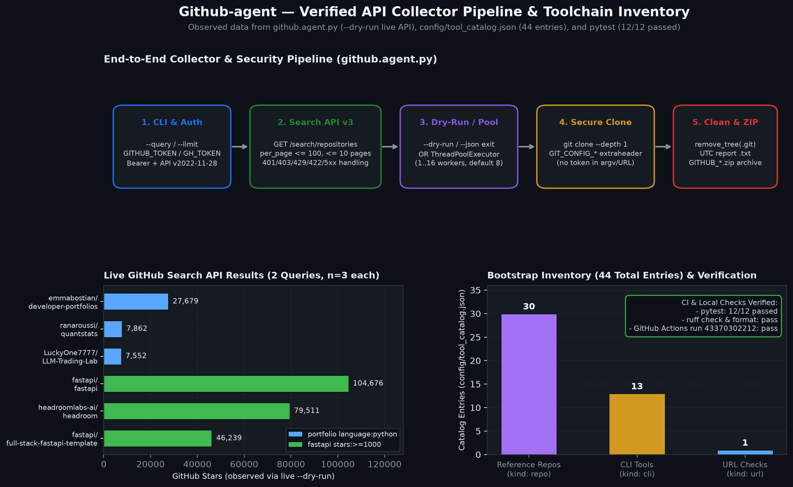
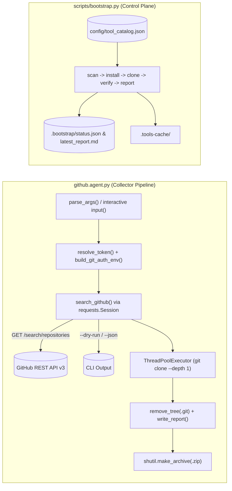

# Case study: GitHub REST Search collector and declarative toolchain ledger

## The problem and scope

This repository pairs two small Python systems:

1. **`github.agent.py`** searches GitHub repositories via the REST Search API, shallow-clones matched projects concurrently, removes `.git` directories, and packages a ZIP archive alongside a plain-text report.
2. **`scripts/bootstrap.py`** reconciles a local workstation against `config/tool_catalog.json` (44 entries: 13 CLIs, 30 reference repositories, 1 URL), tracking what is installed, cloned, and verified in `.bootstrap/status.json` and `.bootstrap/latest_report.md`.

The original collector (November 2025) was interactive-only (`input()` prompts), embedded pasted tokens directly into `git clone` URLs, lacked unit tests, and had unpinned requirements. The bootstrap layer (March 2026) added the catalog, `Taskfile.yml`, `.mise.toml`, `lefthook.yml`, and GitHub Actions CI.

## Architecture overview

## GitHub API & credential engineering

### REST Search API client (`requests.Session` vs PyGitHub/`httpx`)

`github.agent.py` intentionally calls `https://api.github.com/search/repositories` directly with `requests.Session` (and invokes `git` CLI subprocesses for shallow clones) rather than pulling in PyGitHub or `httpx`. `gh` CLI is tracked separately as a catalog dependency in `config/tool_catalog.json` and verified by `scripts/bootstrap.py`.

Key API engineering choices in `search_github()`:

- **Versioned headers & Bearer auth**: Sends `Accept: application/vnd.github+json`, `X-GitHub-Api-Version: 2022-11-28`, and `Authorization: Bearer <token>` (supporting both classic and fine-grained PATs resolved from `--token`, `GITHUB_TOKEN`, or `GH_TOKEN`).
- **Bounded pagination & deduplication**: Requests `per_page = min(100, max(1, limit - len(repos_found)))` to avoid over-fetching on small queries, respects the Search API's 10-page (1,000-result) ceiling, short-circuits on `total_count` or short pages, and deduplicates `full_name` across pages if star rankings shift mid-query.
- **Explicit status & rate-limit handling**:
  - `401` fails fast on bad/expired tokens.
  - `403` and `429` inspect `X-RateLimit-Remaining`, `X-RateLimit-Reset` (formatted as UTC ISO-8601), and `Retry-After`, then stop paging while keeping any repositories already collected.
  - `422` surfaces invalid query syntax cleanly.
  - `5xx` performs bounded retry with configurable backoff.

### Keeping tokens out of `git clone` URLs

An earlier iteration rewrote `https://github.com/...` into `https://<token>@github.com/...`, which exposed credentials in process argument lists during `git clone`. `build_git_auth_env()` replaces URL rewriting with Git environment configuration:

- `GIT_TERMINAL_PROMPT=0` prevents interactive hangs on private or missing repos.
- `GIT_CONFIG_COUNT=1`, `GIT_CONFIG_KEY_0=http.https://github.com/.extraheader`, and `GIT_CONFIG_VALUE_0=AUTHORIZATION: basic <base64(x-access-token:TOKEN)>` inject credentials through process environment variables instead of CLI arguments or URLs.

### Cross-platform cleanup and non-interactive automation

- **Windows/POSIX `.git` removal**: Git packfiles under `.git/objects/pack/` are marked read-only, which causes `shutil.rmtree(..., ignore_errors=True)` to leave `.git` directories behind on Windows. `remove_tree()` passes an `onexc` handler (`_handle_remove_readonly`) that grants write permission before unlinking.
- **CLI & dry-run UX**: `parse_args()` adds `--query`, `--limit`, `--language`, `--min-stars`, `--token`, `--workers`, `--output-dir`, `--dry-run`, and `--json`, while preserving interactive prompts when `--query` is omitted.
- **Windows shim resolution in bootstrap**: `scripts/bootstrap.py`'s `run_cmd()` resolves `cmd[0]` with `shutil.which(cmd[0])`, fixing `.cmd` shims such as `npm.cmd` on Windows without altering Linux CI behavior.

## Tools, Skills, APIs & Engineering Practices Demonstrated

- **APIs**: GitHub REST Search API v3 (`GET /search/repositories`, pagination, `X-RateLimit-*` / `Retry-After` handling, `X-GitHub-Api-Version`), HTTPS Git transport with `GIT_CONFIG_*` header auth.
- **Python & Concurrency**: `requests.Session`, `ThreadPoolExecutor`, `subprocess`, `argparse`, `zipfile`/`shutil`, `tqdm`, timezone-aware `datetime.now(tz=UTC)`, bounded `requirements.txt` and `requirements-dev.txt`.
- **Verification & CI/CD**: 12 `pytest` tests (`tests/test_github_agent.py`, `tests/test_bootstrap.py`) using mocked HTTP sessions, mocked `subprocess.run`, and `tmp_path` ZIP/report verification; `ruff check` and `ruff format --check` configured in `pyproject.toml`; `Taskfile.yml`, `lefthook.yml`, `.mise.toml`, and GitHub Actions (`.github/workflows/bootstrap-check.yml`).

## Verified execution summary

Initial Linux CI and verification history (13 November 2026) resolved 14 pre-existing Ruff lint findings and fixed the GitHub Actions workflow (`Bootstrap Checks` run `43351099399` passed `ruff check`, `task bootstrap:scan`, and `task doctor` on Python 3.13.18).

Following the collector CLI, security, error-handling, and test-suite upgrades in this pass:

1. `ruff check .` and `ruff check . --isolated` exited `0` (`All checks passed!`).
2. `ruff format --check .` exited `0` (`10 files already formatted`).
3. `uv run --no-project --with-requirements requirements.txt --with pytest pytest -v` exited `0` (`12 passed in 2.15s`).
4. Live GitHub Search API dry-run (`python github.agent.py --query "portfolio" --language python --limit 3 --dry-run`) returned `emmabostian/developer-portfolios` (27,679★), `ranaroussi/quantstats` (7,862★), and `LuckyOne7777/LLM-Trading-Lab` (7,552★) without cloning or creating archives.
5. `python scripts/bootstrap.py scan`, `verify`, and `report` exited `0`, verifying `gh`, `uv`, `ruff`, and `skills.sh` (`HTTP/2 308`). `bootstrap.py doctor` reported `OK` for `git`, `uv`, `ruff`, `node`, and `npm` (`11.17.0`), and `FAIL` for host-absent `python3` alias, `task`, `mise`, and `lefthook` on Windows.

Full verbatim transcripts are recorded in [docs/PROOF_OF_WORK.md](PROOF_OF_WORK.md).
